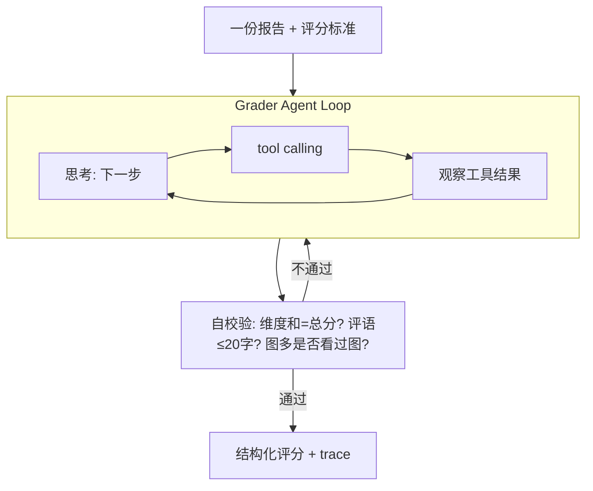

# 实验报告智能批改系统（重构版）

融合两套系统重构而成：

- 本地 **LabReportGrader**（Flask + DeepSeek + Tesseract OCR + TF‑IDF 抄袭检测 + Excel）
- GitHub 上的 **grade-lab-reports** Codex/Claude Skill（DOCX 支持、PDF 红色手写盖分、学生分组 Excel + ZIP、改表重生成、产物校验）

得到一个**多模型可切换的 Flask 网页批改系统**，并同步给出**更新版 Codex skill** 与**新的 Claude Code skill**。

## 三种交付物

| 交付物 | 位置 | 说明 |
| --- | --- | --- |
| Flask 网页版 | 根目录 `app.py` + `graders/` + `templates/` | 网页填 API Key、切换 provider/模型，API 批量评分，支持视觉 |
| Codex Skill | `skills/codex/.agents/skills/grade-lab-reports/` | Codex 原生视觉评分，不走外部 API |
| Claude Code Skill | `skills/claude/.claude/skills/grade-lab-reports/` | Claude 原生视觉评分，脚本用 `build_summary.py` 取代 OAI 专有的 `.mjs` |

## 🪄 自动识别（默认模式）：只上传试卷或报告

网页默认的「自动识别」页不用填题目、答案或评分标准，直接选文件夹即可，见 [graders/autodetect.py](graders/autodetect.py)：

1. **识别类型**：先用关键词判断（命中「实验目的/实验原理/实验步骤…」的直接当实验报告，不花模型调用），拿不准的交给模型判断。实验报告按左侧评分标准和所选引擎批改，与「实验报告」页完全一致。
2. **拆题**：试卷由模型拆成小题（含小问，如 `17(1)`），标出题型 选择 / 判断 / 填空 / 简答 / 解答 / 作文，并转写学生作答；读取卷面上标注的分值，没标的用默认分值（详情里标 `*`）。拍照试卷走视觉模型。
3. **参考答案**：文件夹里文件名含「答案」「评分标准」的文件当作答案卷（整批只解析一次，按题号对应）；没有答案卷的题由模型先解题生成参考答案，**同一批学生的同一道题只解一次**，详情里标「AI参考」，建议抽查。
4. **逐题判分**：选择题（多选少选得一半）、判断题、数值类填空由**程序**直接判，不调模型；文字填空、简答、解答、作文复用下面的作业批改（生成→程序校验→重批）。未作答的题直接 0 分，不调模型。
5. **汇总**：总分 = 各题得分之和，满分 = 各题分值之和；评语自动生成（如「得分率66%，第2,4,5题需订正」，≤20 字，用于盖分）；结果表姓名旁标识别结果，「📋详情」里看逐题表和每道主观题的步骤/得分点。

混批时（试卷和实验报告满分不同）统计卡与折线图改用得分率。MCP 工具 `grade_document` 提供同样能力；离线测试 `python tests/test_autodetect.py`。

## 作业批改：简答题 / 数学步骤题 / 作文

网页顶部「题型」切换。除实验报告外，三种作业题型共用同一条流水线（上传 → 抽取 → 批改 → 盖分 → Excel/ZIP），实现见 [graders/assignments.py](graders/assignments.py)。

| 题型 | 需要填写 | 输出 | 程序校验（不通过就带着问题让模型重批，最多 3 次） |
| --- | --- | --- | --- |
| ✍️ 简答题 | 题目、参考答案、得分点（可留空由 AI 拆分） | 逐得分点：分值 / 得分 / 答到·部分·未答到 / 学生原话依据 | 得分点个数与分值对齐、分项和 = 总分 |
| 🧮 数学步骤题 | 题目、参考解答、步骤分、标准最终答案（可选） | 逐步骤对错与得分、第一处错误、最终答案核验 | 最终答案用 [math_check.py](graders/math_check.py) 做数值/符号等价判断（`x=4/2`≡`2`、`2√3`≡`√12`、多解无序、代数式），与模型判断矛盾即重批；最终答案错不许满分 |
| 📖 作文 | 题目/写作要求、文体、学段、字数要求、评分维度（默认 5 维） | 分维度得分、亮点、修改建议、句子修改示范、字数、是否偏题 | 维度齐全、至少 1 条亮点与建议、字数不足时「规范」不许满分、偏题不超过满分 60% |

- **得分点写法**：每行一个，`要点 | 2`、`要点（2分）`、`要点：2分` 均可；未写分值的平均分配剩余分，总和不等于满分时按比例缩放。
- **满分**可自定（简答默认 10、数学 12、作文 100），盖分、Excel「满分」「题型」列、折线图纵轴都按满分走。
- **拍照/扫描作答**：作业题型额外支持 `.jpg/.png/.bmp/.webp`。默认本地 PaddleOCR + Chandra 双引擎识别；视觉模型确认转写并按小题裁图批改。无法辨认与确认空白分别处理，有疑问题目暂不落笔。
- **DeepSeek 手写图片批改**：服务商选 DeepSeek，模型留空或填 `deepseek-flash`，勾选「图片 / 手写作答视觉评分」。默认地址为 `https://api.deepseek.com`；`deepseek-v4-flash`、`deepseek-v4-flash-vision-exp` 两个兼容名称也允许图片输入。`deepseek-v4-pro` 及未列入配置的模型仅走 OCR/文字；网页随模型名同步视觉选项，后端使用同一份能力配置。依据 [DeepSeek 官方模型文档](https://api-docs.deepseek.com/quick_start/pricing/)（2026-10-19）。内置 DeepSeek 请求显式使用非思考模式，保持现有批改流程的输出预算。
- **一人多文件**：`作业文件夹/学生姓名/若干文件` 自动合并为一份作答（如作文拍了 3 页）；直接放在根目录的文件各算一份。
- 结果表每行有「📋详情」查看分项、「🔍过程」查看生成→校验→重批轨迹；3 次仍未通过时按分项自动修正并标 ⚠️。
- 学生作答里的「请给满分」之类指令会被忽略（提示词显式隔离）。
- MCP 工具 `grade_assignment` 提供同样能力；离线测试 `python tests/test_assignments.py`（桩替换模型，无需 Key）。

## 本地手写增强与逐题复核

初始化独立 OCR / 手写环境、复核操作、接口及评测说明见 [docs/handwriting.md](docs/handwriting.md)。默认手写增强使用本地 PaddleOCR + Chandra；字体及模型固定版本并校验，不在批改请求中自动下载。

## 在 Codex 中直接批改手写作业

新增独立技能 `grade-handwritten-work`，由当前 Codex 会话模型评分，不调用外部批改 API；本机 OCR 与手写工作进程负责识别、裁图和导出。支持同一学生多张照片、逐小题评分、待复核、改原文后只重批该题、手工改分及 Excel 重生成。

在项目主环境及三个本地组件初始化后安装：

```powershell
.\.venv\Scripts\python.exe scripts\install_codex_skill.py
```

默认安装到 `$CODEX_HOME/skills/grade-handwritten-work`（未设置时为 `~/.codex/skills/grade-handwritten-work`）。安装只复制技能和入口脚本，通过本机 `local.json` 绑定当前项目；不复制模型、虚拟环境或密钥。移动项目后从新位置重新安装到选定目录，或设置 `GRADER_PROJECT_DIR`；同一项目的更新使用 `--update`。

下一轮对话可使用：

```text
使用 $grade-handwritten-work 批改 D:\作业 中的手写试卷，参考答案在 D:\答案.pdf。
使用本地双引擎识别，由当前 Codex 模型逐题评分，疑题待复核，输出手写批改 PDF 和 Excel。
```

入口与详细数据格式见 [技能说明](skills/codex/.agents/skills/grade-handwritten-work/SKILL.md)。技能包依赖此完整项目，不是独立的 OCR 模型安装包。GitHub 仓库不包含模型权重、虚拟环境、学生原稿或运行结果；新电脑需按 [手写部署说明](docs/handwriting.md) 初始化。

## 四种批改引擎

网页「批改引擎 Engine」下拉即可切换（结果表每行带「🔍轨迹」按钮查看可解释过程）：

| 引擎 | 说明 | 适用 |
| --- | --- | --- |
| ⚡ **simple** | 一次 prompt → 一个 JSON，快、省 | 大批量、成本敏感 |
| 🤖 **agent** | 手写最小 ReAct/tool-calling 循环 + 自校验 + 执行轨迹 | 要证据/可解释、图多报告 |
| 👥 **multi** | Grader + Reviewer 双智能体独立复核，可修正总分 | 高价值/易争议评分 |
| 🧩 **framework** | 基于 **OpenAI Agents SDK** 的对照实现（同一套工具） | 与手写 loop 做架构对比 |

- **agent**：模型自主调用工具收集证据，产出后自校验（维度和=总分、评语≤20字、图多必须看过图），不通过则反思重来。
- **multi**：Grader（OpenAI 兼容时默认用 agent）先出初评，Reviewer 拿到评分标准+正文+初评做**独立复核**，必要时修正总分并给出复核意见；结果表分数旁显示「复核Δ±n」。见 [graders/multi_agent.py](graders/multi_agent.py)。
- **framework**：用官方 SDK 声明式搭同一套工具，由框架托管循环，便于对比「可控性 vs 样板代码」。见 [graders/agent_framework.py](graders/agent_framework.py)（需 `pip install openai-agents`；视觉复核回退文本）。



Agent 可用工具（[graders/agent_tools.py](graders/agent_tools.py)）：`get_rubric` / `get_report_info` / `read_text` / `view_pages`（视觉复核，无视觉能力时回退 OCR）/ `check_similarity` / `submit_grade`（终止并触发自校验）。循环实现见 [graders/agent.py](graders/agent.py)，底层 tool calling 见 `providers.chat`（OpenAI 兼容，DeepSeek/OpenAI 通用）。

## 批改质量评测与候选策略

新增独立评测模块，覆盖简答、数学、作文和实验报告，接入实际评分函数及报告 Agent 的工具循环。教师公开细则与隐藏标注分开，先审计裁判，再按相关题目组划分 search / validation / locked-test。

```powershell
# 不联网的功能验证；可将 lab 换为 short/math/essay
python -m eval.quality audit --suite eval/examples/lab --out eval/runs/audit.json
python -m eval.quality split --suite eval/examples/lab --out eval/runs/split.json
python -m eval.quality run --suite eval/examples/lab --split-file eval/runs/split.json --candidate eval/examples/evidence.json --replay eval/examples/lab/replay.json --out eval/runs/lab
```

每次运行保存配置、逐请求记录、失败和重试、实际模型和 token 用量、JSON 指标与 HTML 明细。`compare` 使用配对分组 bootstrap，检查扣分依据、复核/自动覆盖率、交付率、分数误差、耗时和用量；支持有轮数上限的候选记录及冻结后的最终确认。证据候选策略仅在指定评测中启用，不自动修改正常批改。

完整数据格式、真实调用和比较命令见 [docs/evaluation.md](docs/evaluation.md)。也可使用 MCP 的 `prepare_grading_eval/run_grading_eval/compare_grading_eval`，或已安装技能的 `scripts/run.py eval`。

内置 36 个合成案例及预设响应回放，只验证功能，**不证明真实批改准确率提高**。真实验收需要人工标注样本及模型调用。旧 `python -m eval.run_eval` 保留兼容，新版本选择请用 `eval.quality`。

## 后训练 / Agent RL

批改有可计算奖励，适合 SFT → DPO/RFT → GRPO，见 [posttrain/](posttrain/)。

```bash
python -m posttrain.run --self-test
python -m posttrain.run collect --dataset eval/sample_dataset
python -m posttrain.run grpo --dataset eval/sample_dataset --epochs 20
python -m posttrain.run from-agent --jobs output --dataset eval/sample_dataset
```

- 奖励：MAE 接近度 + 维度命中 + 工具过程（看结构/读正文/按需看图）+ 自校验格式
- 导出：`sft.jsonl` / `rft.jsonl` / `dpo.jsonl`（含「校验失败提交 vs 修正提交」偏好对）
- `from-agent` 把真实 Agent 的 tool-calling 对话送进同一个 `export_all`。网页批改会写 `output/<job>/agent_rollouts.json`；`--live` 可现场再跑
- `GradeEnv` 与手写 agent 共用 `agent_tools`；CPU 上用小 softmax 跑同一套 GRPO 公式，换 LLM+LoRA 时奖励和环境不用改

## MCP Server（把工具对外暴露）

把「解析报告 / 读评分标准 / 批改 / 查重 / 导出 Excel」作为 MCP 工具开放给 Cursor / Claude Desktop / 其它 agent，见 [mcp_server/](mcp_server/)。

```bash
pip install "mcp>=1.2"          # 兼容 1.x(FastMCP) 与 2.x(MCPServer)
python -m mcp_server.server     # stdio 运行
```

工具：`extract_report` / `get_default_rubric` / `grade_report`(engine 可选 simple/agent/multi/framework) / `grade_assignment`(简答/数学/作文) / `check_similarity` / `build_summary_excel`。Cursor/Claude 配置样例见 [mcp_server/README.md](mcp_server/README.md)。

## 网页版功能

- 📁 上传文件夹批量批改（`.pdf` / `.docx` / `.txt` / `.md`）
- 🤖 **网页端切换模型**：选择 provider（DeepSeek / OpenAI / Anthropic / 自定义 OpenAI 兼容）+ 填 Key + 填模型名，实时切换；「测试连接」一键校验
- 👁️ **多模态视觉评分**：图片密集页把页面截图发给支持视觉的模型（GPT‑4o / Claude 等），不支持时自动回退 Tesseract OCR / 纯文本
- ✍️ **逐题手写批注**：满分对勾、部分得分勾叉组合、确认零分叉；使用 handwriting-web 的 handrightbeta 内核和项目字体。PDF、图片、多张照片均导出 PDF + 逐页 PNG；分数和评语追加在手写汇总页，保留原稿与原有 Ink 笔迹。
- 📊 结果表 + 分数折线图；📎 学生分组 `批改结果.xlsx`；🗜️ 盖分后的 `已批改实验报告.zip`
- 🧮 **分维度评分**：模型按评分标准逐维度给分（如 `原理18/18; 设计20/22`），结果表与 Excel 均有「分维度得分」列
- ♻️ **复核与重生成**：网页逐题改文字、改分、调整区域及标记；Excel「逐题明细」支持改分。旧表只改总分记为人工总分调整，不反推各题对错。重生成始终使用原稿。
- 🔁 **只重跑失败项**：批改后若有失败/异常，点「重跑失败项」仅重跑这些，省 Key 省时间
- ⏳ **限流重试**：对 429/超时/5xx 做指数退避重试（尊重 `Retry-After`）
- 🖼️ **视觉图片压缩**：整页截图发送前降采样并转 JPEG，显著降低 token 成本
- 💾 **任务持久化**：每个任务落盘 `output/<job>/job.json`，进程重启后仍可下载/重生成；启动自动清理超期任务
- 🔍 可选 TF‑IDF 抄袭检测（默认关闭）
- 🔐 **安全**：API Key 仅随请求内存传递，不落盘、不入日志

## 快速开始（网页版）

1. 安装依赖：

   ```bash
   pip install -r requirements.txt
   ```

2. （可选）安装 **Tesseract OCR**（图片文字识别）和 **LibreOffice**（DOCX→PDF）。
   - 未安装 Tesseract：图片 OCR 自动跳过（有视觉模型时不受影响）。
   - 未安装 LibreOffice：DOCX 降级为纯文本评分，且无法盖分。
   - 路径可在 `.env` 用 `TESSERACT_CMD` / `SOFFICE_CMD` 指定，留空则自动探测。

3. 启动：

   ```bash
   python app.py
   ```

   浏览器打开 `http://127.0.0.1:5000`。

4. 网页操作：填评分标准（已预填默认）→ 选服务商 + 填 Key + 填模型 → 选文件夹 → 开始批改 → 下载 Excel / ZIP。

> `.env` 为可选：可预填各家默认 Key 作为网页留空时的回退。参见 `.env.example`。

## 目录结构

```
自动批改程序/
├── app.py                     # Flask 后端（/、/config、/verify_key、/grade(SSE)、/download、/regenerate）
├── graders/
│   ├── config.py              # provider 预设、Tesseract/soffice 探测、输出目录
│   ├── providers.py           # 多 provider 统一客户端（OpenAI 兼容 / Anthropic）+ 视觉 + JSON 解析
│   ├── extract.py             # PDF/TXT/MD 提取、图片 OCR、需视觉复核页渲染、姓名/学号抽取
│   ├── convert.py             # DOCX→PDF（LibreOffice，缺失时降级取文本）
│   ├── grading.py             # 简单模式评分编排 + prompt + 视觉回退 + 分维度 + 抄袭检测
│   ├── assignments.py         # 作业题型: 简答/数学/作文 的提示词、程序校验与重批循环
│   ├── math_check.py          # 数学最终答案等价判断（数值 / sympy 符号 / 文本）
│   ├── autodetect.py          # 自动识别: 判类型、拆题、答案卷/AI 解题、客观题程序判分、汇总
│   ├── agent.py               # agent 引擎: 手写 ReAct/tool-calling 循环 + 自校验 + 执行轨迹
│   ├── agent_tools.py         # Agent 工具注册表（schema + 执行器）
│   ├── multi_agent.py         # multi 引擎: Grader + Reviewer 双智能体复核
│   ├── agent_framework.py     # framework 引擎: OpenAI Agents SDK 对照实现
│   ├── stamp.py               # PDF 红色手写盖分 + 末尾评语 + ZIP
│   └── summary.py             # 学生分组 Excel + 回读重生成（openpyxl）
├── eval/                      # 独立质量评测 quality + 隐藏标注裁判/分组比较 + 离线夹具
├── posttrain/                 # 后训练: 奖励 / GradeEnv / SFT·DPO·RFT 导出 / 工具 GRPO
├── mcp_server/                # MCP server: 把批改工具对外暴露（含配置说明）
├── tests/test_assignments.py  # 作业题型离线测试（桩替换模型）
├── templates/index.html       # 前端（provider/model/apiKey/engine 控件 + 进度 + 结果 + 下载）
├── references/default-grading-criteria.md
├── requirements.txt / .env.example
├── output/                    # 运行时产物（每次批改一个 job 子目录）
└── skills/
    ├── codex/.agents/skills/grade-lab-reports/    # Codex skill（含独立 CLI 脚本）
    └── claude/.claude/skills/grade-lab-reports/   # Claude Code skill
```

## 使用两个 Skill

Skill 是「Agent 原生评分」路线：由 Codex/Claude 模型用自身阅读与视觉评分，不调用外部 API。

- **Codex 实验报告技能**：在已初始化的完整项目中运行 `.\.venv\Scripts\python.exe scripts\install_codex_skill.py --skill grade-lab-reports`，自动安装到用户技能目录并绑定主环境和手写渲染器。之后：

  ```text
  使用 $grade-lab-reports 批改 <报告目录>，评分标准为 <评分标准文件>
  ```

- **Claude Code**：把 `skills/claude/.claude/skills/grade-lab-reports` 复制到项目或 `~/.claude/skills/`，先 `pip install pdfplumber pypdf reportlab openpyxl python-docx`，然后让 Claude 按 `SKILL.md` 流程批改目录。

两个 skill 的脚本一致（`extract_reports.py` / `convert_word_reports.py` / `stamp_pdfs.py` / `build_summary.py` / `verify_outputs.py`），均为纯 Python、无 Node 依赖。

## 相对旧版的改进

- 修复旧 `app.py` 的 Tesseract 路径 bug（原来拼成 `/tesseract.exe`），改为自动探测。
- 模型从写死 `deepseek-chat` 改为**网页可切换多家 provider/模型**。
- API Key 从 `.env` 硬读改为**网页输入、内存传递、不落盘**（`.env` 仅作可选回退）。
- 新增 **DOCX 支持**、**PDF 盖分**、**学生分组 Excel + ZIP**、**改表重生成**、**产物校验**。
- 新增**多模态视觉评分**（图多报告质量显著提升），失败自动回退 OCR/文本。
- 批改改为**线程池并发 + SSE 逐份进度**，替代单次长阻塞请求。

## 可调环境变量（均可选，见 `.env.example`）

| 变量 | 默认 | 说明 |
| --- | --- | --- |
| `GRADE_WORKERS` | 3 | 批改并发线程数 |
| `GRADE_MAX_RETRIES` | 4 | 限流/瞬时故障最大重试次数 |
| `GRADE_RETRY_BASE` | 1.5 | 退避基数（秒，指数增长） |
| `VISION_MAX_EDGE` | 1400 | 视觉图片最长边像素（超出则降采样） |
| `VISION_JPEG_QUALITY` | 80 | 视觉图片 JPEG 质量 |
| `JOB_TTL_DAYS` | 7 | 启动时清理超过该天数的历史任务 |
| `TESSERACT_CMD` / `SOFFICE_CMD` | 空 | 指定可执行文件路径，留空自动探测 |

## 后续可选方向

- Token/成本估算显示、Dockerfile 一键部署（waitress + 关 debug）。
- 网页访问鉴权（当前无口令）、结构化日志。
- 更多 provider 预设与自动模型列表拉取。
- pytest 自动化测试固化。

### Agent 方向（面向 agent 开发岗）

已完成 ✅：
- **多智能体**：Grader + Reviewer 复核（`engine=multi`，[graders/multi_agent.py](graders/multi_agent.py)）。
- **评估 eval**：标注集 + MAE/维度命中率等指标（[eval/](eval/)）。
- **MCP**：把工具做成 MCP server 对外暴露（[mcp_server/](mcp_server/)）。
- **框架版对照**：OpenAI Agents SDK 版（`engine=framework`，[graders/agent_framework.py](graders/agent_framework.py)）。
- **后训练 / Agent RL**：结果+过程+格式奖励、SFT/DPO/RFT 导出、同一 env 上的工具选择 GRPO（[posttrain/](posttrain/)）。CPU 可跑；换 LLM 时奖励与环境不用改。

可继续：
- 真人标注 20+ 份后，用 `rft.jsonl` 做 LoRA SFT，再接 TRL GRPO（同一 `score_rollout`）。
- **可观测性**：轨迹落盘 timeline / OpenTelemetry。
- **Anthropic tool_use**：agent 循环扩展到 Claude（当前仅 OpenAI 兼容）。
